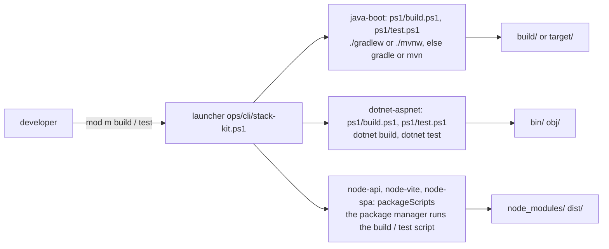
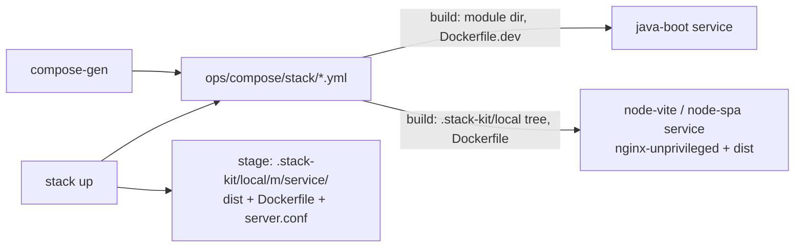
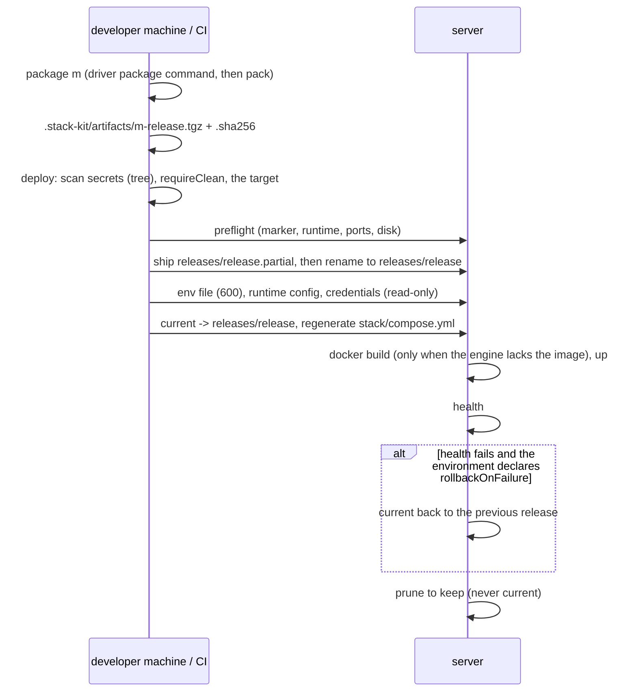
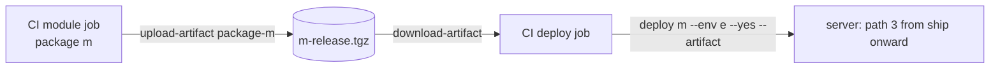
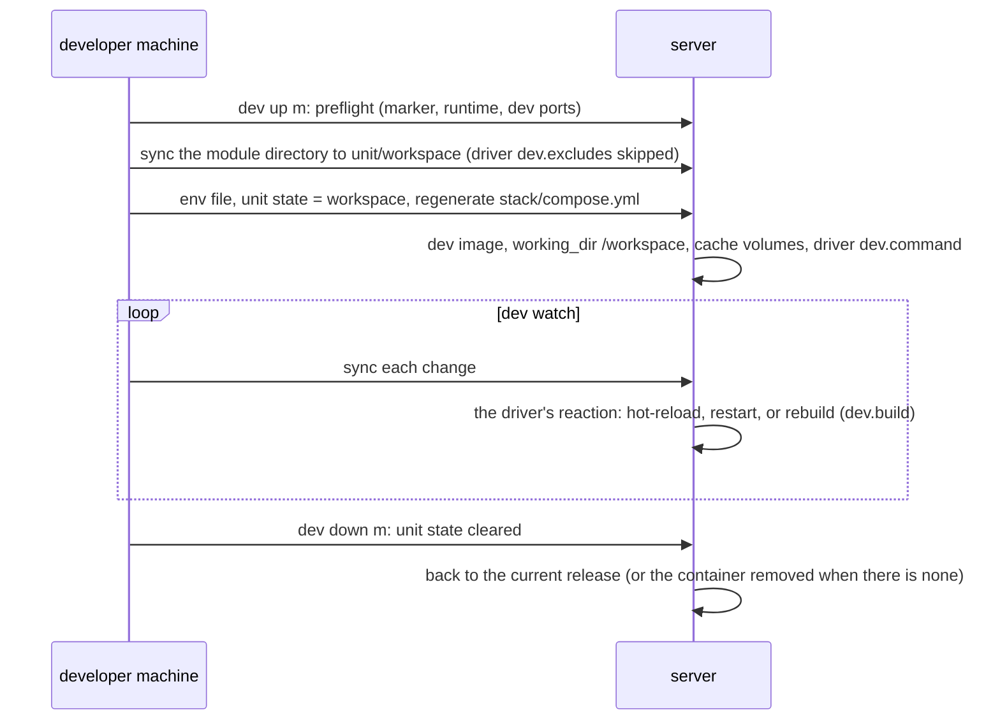
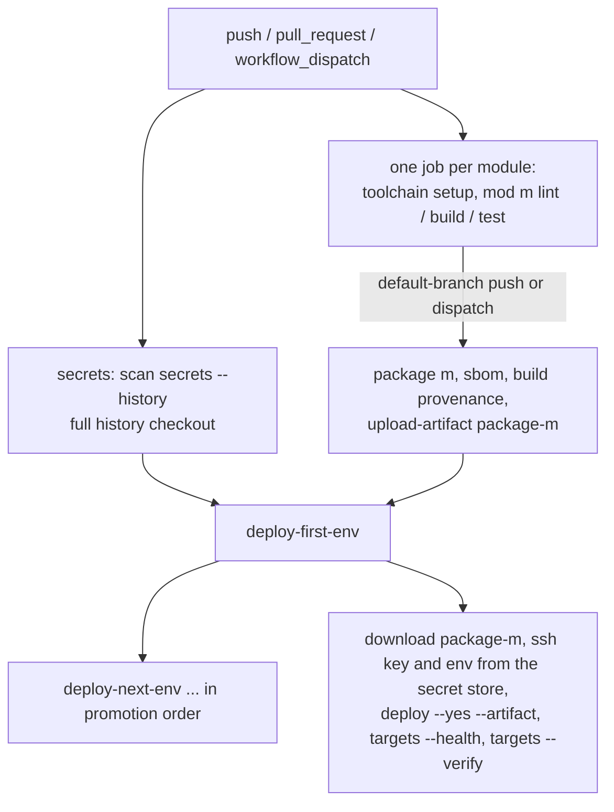

# Delivery paths -- every way a module goes from code to running

This page draws each path a module takes, for the backend drivers (`java-boot`, `dotnet-aspnet`,
`node-api`) and the frontend drivers (`node-vite`, `node-spa`): what runs, on which machine, and which
files land where. It copies no declaration. The verbs are in [`docs/OPERATIONS.md`](../OPERATIONS.md),
each driver's declarations in [`drivers/registry.json`](../../drivers/registry.json), and the server
layout in [`config/deploy-layout.default.json`](../../config/deploy-layout.default.json), the layout's
one home. [server-layout.md](server-layout.md) explains that layout.

| path | command | where it compiles | where it runs |
|---|---|---|---|
| 1. local build and test | `mod <m> build`, `mod <m> test` | this machine | -- |
| 2. local stack | `stack up` | this machine (in a container) | this machine |
| 3. release | `package <m>`, then `deploy <m> --env <e>` | this machine, or CI | the server (a thin runtime image) |
| 4. release from CI's archive | `deploy <m> --env <e> --artifact <archive>` | CI | the server |
| 5. remote dev | `dev up`, `dev watch`, `dev down` | the server, in the dev image | the server |
| 6. CI | `ci-gen` writes `.github/workflows/ci.yml` | the CI runner | the server (deploy jobs) |

## The local tree these paths use

```text
<host>/
  stack-kit.json                       the manifest
  apps/<module>/                       each module's source (its manifest path)
    build/ target/ .gradle/            java-boot outputs      (registry outputs; never tracked)
    bin/ obj/                          dotnet-aspnet outputs
    node_modules/ dist/ .angular/      node-* outputs
  ops/
    cli/stack-kit.ps1                  the launcher
    config/<module>/.env.<env>         each module's env values (ignored; *.example kept)
    compose/stack/                     the local compose files (compose-gen)
    compose/stack/<env>/compose.yml    the stack compose a deploy runs (render)
    containers/<module>/Dockerfile     the release recipe (render; + server.conf for a ui module)
    deploy/targets.json                where each deploy goes
  .stack-kit/                          ignored
    artifacts/<module>/                the package step's staging directory ({out})
    artifacts/<module>-<release>.tgz   one archive per commit, with <archive>.sha256 beside it
    local/<module>/<service>/          a release tree staged for the local stack (frontend drivers)
    runs/runs.jsonl                    the run records
```

## 1. Local build and test

`mod <m> build` and `mod <m> test` run the module's driver command on this machine
(`lib/modules.py` `driver_commands`). The outputs stay in the module's own directory and are never
tracked: `validate` refuses a tracked file that a driver's `outputs` matches.



| driver | build | test | outputs (registry `outputs`) |
|---|---|---|---|
| java-boot | Gradle `build -x test`, Maven `package` without tests | the build tool's tests | `build/`, `.gradle/`, `target/` |
| dotnet-aspnet | `dotnet build` of the solution or project | `dotnet test` of `dotnet.test` | `bin/`, `obj/` |
| node-api | `build` script | `test` script | `node_modules/`, `dist/` |
| node-vite | `build` script | `test` script | `node_modules/`, `dist/` |
| node-spa | `build` script | `test` script | `node_modules/`, `dist/`, `.angular/` |

## 2. The local stack

`compose-gen` writes the local compose files into `stack.composeDir` (`ops/compose/stack` by default).
`stack up` first stages the release tree of every frontend module, then runs compose with each module's
`ops/config/<module>/.env` and `.env.<environment>`.



- **java-boot** builds its local service from the module's own recipe: `Dockerfile.dev`, or `Dockerfile`
  with `stack --prod` (compose templates `module_java_api_dev` / `_prod`). **A java-boot module without
  that file is left out of the local stack**: `compose-gen` prints `skip modules.<m> has no
  Dockerfile.dev ...` and writes no service for it. java-boot declares no `compose.fromRelease`, so it
  never falls back to its release image. Add the recipe, or run the module with `mod <m> build` and its
  own `bootRun`.
- **node-vite, node-spa** run their release image (`compose.fromRelease: true`): `stack up` stages
  `.stack-kit/local/<m>/<service>/` from what the package step left (`dist/`), and compose builds
  the same recipe a deploy builds. The package step must have run first.
- **dotnet-aspnet, node-api** declare no `compose.templates`, so the local stack has no service for
  them, even when the module has a `Dockerfile.dev`: `compose-gen` prints `skip modules.<m> (<driver>)
  has no local dev service: its driver declares no compose template for role <role> ...` and goes on.
  Use path 1 or path 5.

## 3. A release: `package`, then `deploy`

The release is built **once**, on the developer's machine or in CI. The server never compiles: it
builds only a thin runtime image from the shipped bytes.



### What `package` puts in the archive

`package <m>` runs the driver's `package` command, then `pack`
(`lib/package.py`) writes `.stack-kit/artifacts/<m>-<release>.tgz`. The release id is the commit, with
`-dirty` when the checkout was dirty.

```text
<m>-<release>.tgz
  release.json            provenance: module, release id, commit, git describe, dirty, services, excluded
  <service>/
    Dockerfile            the module's own recipe, else the driver's template rendered for it
    ...                   the driver's artifacts:
```

| driver | artifacts in `<service>/` (registry `package.artifacts`) | recipe (driver `container.template`) |
|---|---|---|
| java-boot | the boot jar (`build/libs/*.jar`, `target/*.jar`, also one module deep; `*-plain.jar` excluded) | `eclipse-temurin:<v>-jre`, user uid 10001, `java -jar /app/app.jar` |
| dotnet-aspnet | the `dotnet publish` output (`{out}` = `.stack-kit/artifacts/<m>/`) | `mcr.microsoft.com/dotnet/aspnet:<v>`, `USER app` (uid 1654), `dotnet <project>.dll` |
| node-api | `dist/**` plus `package.json` and the lockfile | `node:<v>-alpine`: a production-only install (`--prod` / `--omit=dev`), then `USER node`, `npm start` |
| node-vite, node-spa | `dist/**` + `server.conf` (the rendered `spa.conf`) | `nginxinc/nginx-unprivileged:1.27-alpine`, `USER nginx`, `/healthz` |

node-api's runtime image installs production dependencies from the shipped lockfile. It never runs a
build: `dist/` arrives already compiled.

### The server tree

The paths come from [`config/deploy-layout.default.json`](../../config/deploy-layout.default.json)
(a target may override any of them in `layout`). With the default layout:

```text
{root}/                                   shared between projects; never acted on
  {project}/
    {env}/
      {tier}/{service}/                   the unit (tier from the service's role: backend, frontend)
        releases/<release>/               one shipped tree per packaged commit (<release>.partial while shipping)
        current -> releases/<release>     the pointer deploy and rollback move
        runtime/                          runtime config, credentials, generated secrets (mounted read-only)
        logs/                             upload.log and the service's logs
        workspace/                        remote dev only (a workspace environment)
      stack/
        compose.yml                       the environment's one compose file, regenerated on every change
        env/<service>.env                 each service's env file (mode 600)
        state.json                        each unit's state: its release, or workspace mode
      infra/                              the environment's infra stack
      backups/                            what a backup of the environment writes
```

Each service's image is `build: {context: releases/<release>}`, tagged per project, environment,
service and release (`lib/delivery/stack.py`). A second deploy of the same release writes nothing.

### Health, `current`, rollback

- After `up`, the deploy waits for the service's health. If health fails in an environment that
  declares `rollbackOnFailure`, `current` returns to the previous release.
- `release list` shows each unit's releases, newest first, with `current` marked.
- `release rollback` is a transaction. The target release is judged first and refused, with nothing
  changed, when it cannot run. The stack is brought up on it, healthy, and only then does `current`
  move. On any failure the previous release comes back up.

### Dev versus prod rules

The rules are flags on an environment in [`config/catalogs/environments.json`](../../config/catalogs/environments.json).
A host adds or changes an environment in its manifest (`catalogs.environments`), without touching code.

| flag | default | effect | read by |
|---|---|---|---|
| `requireClean` | `prod` | a release from a dirty checkout (or an archive whose `release.json` says dirty) is refused | `lib/cli/verbs/delivery.py`, `lib/delivery/release.py` |
| `rollbackOnFailure` | `prod` | a release whose health fails is rolled back | `lib/delivery/release.py` |
| `requireDigests` | none (a host sets it) | every image a release runs must be pinned by digest | `lib/delivery/checks.py`, `lib/delivery/release.py` |
| `confirm` | `prod` | deploy, rollback and removal ask first (`--yes` answers for CI) | the delivery verbs |
| `workspace` | `dev` | remote dev may run there | `lib/delivery/dev.py` |

## 4. `deploy --artifact`: the archive CI built

`deploy <m> --env <e> --artifact <archive>` ships an archive that was already built, normally by the CI
job that packaged this commit. Nothing is packaged again and nothing is rebuilt. It takes one module.
The checkout's dirty check is skipped, but the archive's own provenance is still judged: a dirty
release is refused where `requireClean` holds. From there the server path is exactly path 3.



## 5. Remote dev: `dev up`, `dev watch`, `dev down`

Remote dev runs only in an environment that declares `workspace` (`dev` by default). Here the server
**does** compile, but in the driver's dev image and never in a release.



| driver | dev image | dev command | port |
|---|---|---|---|
| java-boot | `eclipse-temurin:<v>-jdk` | `./mvnw -q spring-boot:run` when `pom.xml`, else `./gradlew bootRun --no-daemon -x test` | 8080 |
| dotnet-aspnet | `mcr.microsoft.com/dotnet/sdk:<v>` | `dotnet watch run --project <project> --urls http://0.0.0.0:8080 --non-interactive` | 8080 |
| node-api | `node:<v>-alpine` | install, then the `dev` script | 3000 |
| node-vite | `node:<v>-alpine` | install, then `dev --host 0.0.0.0` | 5173 |
| node-spa | `node:<v>-alpine` | install, then the `dev` (else `start`) script `--host 0.0.0.0` | 4200 |

The workspace is `{unit}/workspace`, mounted at `/workspace`. Caches (Gradle and Maven, NuGet,
`node_modules`) are named volumes `{project}-{environment}-{service}-{cache}`. This machine keeps its
sync state in `.stack-kit/dev/<target>-<env>-<service>.json`.

## 6. CI: `ci-gen`

`ci-gen` writes `.github/workflows/ci.yml` from the manifest and the targets (`lib/ci_gen.py`). Every
action is pinned by commit SHA (`lib/ci-actions.json`), and each step calls the same launcher a
developer runs.



- **secrets**: `scan secrets --history` on a full-history checkout. The first deploy job `needs` it,
  and every later deploy job waits for it through the previous one.
- **module jobs** (one each, in parallel): the driver's `ci.setup` toolchain, then the lifecycle steps
  the driver has (`lint`, `build`, `test`) through `mod <m> <step>`. A module that is packaged also runs
  `package`, an SBOM, build provenance and `upload-artifact` (`package-<m>`: the archive, its
  `.sha256`, the SBOM). This happens only on a default-branch push or a manual dispatch.
- **deploy jobs** (one per environment, in promotion order, each gated by its GitHub Environment):
  `download-artifact`, the SSH key and each module's `.env.<env>` from the secret store (written
  outside the checkout), then `deploy <m> --env <e> --target <t> --yes --artifact ...` (path 4),
  `targets --health` and `targets --verify`.

```text
CI runner workspace
  .stack-kit/artifacts/<m>-<release>.tgz      packaged by the module job, uploaded as package-<m>
  .stack-kit/artifacts/<m>-<release>.tgz.sha256
  .stack-kit/artifacts/<m>.spdx.json          the SBOM
  .stack-kit/runs/runs.jsonl                  run records, uploaded as stack-kit-runs-<job>
  $RUNNER_TEMP/<module>.env.<env>             the deploy job's env values (umask 077, never in the checkout)
```
