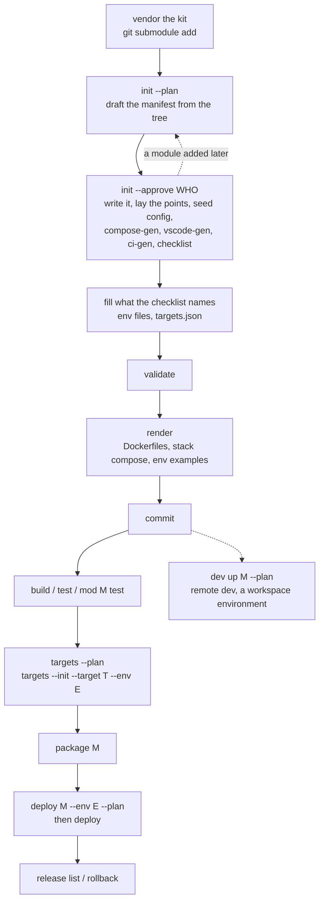

# Setting a project up -- the pipeline, the blueprint, alone or with agent-kit

Every command below was run on a fresh foreign project (a Maven Spring Boot API with a Vite SPA, and a
Gradle Spring Boot API with an Angular SPA) before it was written here. The verbs' own reference is
[`docs/OPERATIONS.md`](../OPERATIONS.md) -- generated from the CLI registry, with the drivers and the
extension points as tables -- and the manifest's is [`manifest.schema.json`](../../manifest.schema.json)
and [`docs/REFERENCE.md`](../REFERENCE.md). This page says the order and the places; it copies neither.

`<kit>` below is where the kit is vendored (`kits/stack-kit` by default); before `init` the launcher is
`pwsh <kit>/cli/stack-kit.ps1`, after it `pwsh ops/cli/stack-kit.ps1` (or `tools/stack-kit.ps1`).

## 1. The pipeline



### A new project

| # | command | what it does | what it writes | what must hold first |
|---|---|---|---|---|
| 1 | `git submodule add <kit-repo> kits/stack-kit` | vendors the kit | `kits/stack-kit/` | a git repository |
| 2 | `pwsh <kit>/cli/stack-kit.ps1 init --plan` | drafts the manifest from the tree: one module per directory a driver's detection holds for (`docs/OPERATIONS.md#drivers`), what each driver reads from it (a Maven build, Spring's `server.port`, an actuator's `/actuator/health`), the `commands` block and one `test-<module>` per module | nothing (prints the `+` additions) | -- |
| 3 | `pwsh <kit>/cli/stack-kit.ps1 init --approve "<who>"` | writes the draft (every field you already declared wins), then lays the extension points init requires for the modules you have, seeds `ops/config/`, generates the local compose files, VS Code launch and tasks, and `.github/workflows/ci.yml`, and prints a checklist | `stack-kit.json`, `ops/`, `tools/`, `.vscode/`, the workflow, per-module files (section 2) | step 2 read the tree you meant |
| 4 | fill what the checklist names | each module's `ops/config/<module>/.env.<env>` (ignored), the ui module's `nginx.env`, and `ops/deploy/targets.json` (one `pending` target) | your values | the checklist's `[ ]` lines; a `[!]` line names a CI workflow the repository already had, now running beside the generated one |
| 5 | `pwsh ops/cli/stack-kit.ps1 validate` | the manifest against its schema, the tree against the declarations, the secrets, the targets, the compose files' recipes, each module's build tool and wrapper | nothing | -- |
| 6 | `pwsh ops/cli/stack-kit.ps1 render` | the projections a deploy ships (`docs/guide/generated-files.md`) | `ops/containers/<module>/Dockerfile` (+ `server.conf` for a ui module), the stack compose per environment of a declared target, the env examples | `validate` green |
| 7 | commit | the setup is a change like any other | -- | `validate` green; `render --check` green |
| 8 | `pwsh ops/cli/stack-kit.ps1 build` / `test` / `mod <module> test` | every module, or one, through its driver (a Maven module: `./mvnw`, else `mvn`; Gradle: `./gradlew`, else `gradle`; with neither, refused by name) | the toolchain's outputs (never tracked) | the toolchain on this machine, or its wrapper committed |
| 9 | `targets --plan`, then `targets --init --target <t> --env <e>` | where each deploy goes, then the remote tree created | the server's tree | a target declared (host, user, an absolute root, `ssh.knownHosts`); a `pending` one refuses every deploy with its reason |
| 10 | `package <module>` | the release archive of this commit | `.stack-kit/artifacts/` (ignored) | a clean checkout where the environment requires one |
| 11 | `deploy <module> --env <e> --plan`, then without `--plan` | the plan (every remote path and command), then the release: preflight, ship, health, rollback on failure | the server's release | the target reachable; the checkout scanned clean |
| 12 | `release list`, `release rollback` | what is released, and a transaction back to an earlier one | -- | -- |

Remote development (`dev up <module> --plan`, `dev sync`, `dev watch`) runs a module's workspace on a
target's workspace environment; it needs a declared target, as a deploy does.

### An existing project

A host already on the kit, or a module added later, takes the same doors:

| command | what it does |
|---|---|
| `migrate` (then `migrate --apply`) | carries values out of a former home (an older manifest shape, `deploy.env`) into the current one |
| `init --plan` | drafts what the tree shows that the manifest does not yet declare: a new module, its `test-<module>`, the fields its driver reads -- absent fields only; nothing declared is changed |
| `extend --list`, `extend <point> [<name>]` | every place you may extend, with its state on this host; one made from its template, never overwriting (`docs/OPERATIONS.md#extension-points`) |
| `validate`, `render --check`, `ci-gen --check` | the tree and its projections against the declarations; a drifted projection is named |

## 2. The blueprint

Each place, with who owns it: **kit-laid** (written once by `init` from a template, yours afterwards),
**yours** (you write it), **generated** (never edited: change the source and regenerate).

| place | purpose | owner |
|---|---|---|
| `stack-kit.json` | the manifest: modules, commands, secrets folder, catalogs (`manifest.schema.json`) | yours (drafted by `init`) |
| `ops/cli/stack-kit.ps1`, `.sh`; `tools/stack-kit.*` | the launchers | kit-laid |
| `ops/config/` | per-module configuration: `<module>/.env.example` tracked, `.env.<env>` ignored; `.gitignore` keeps it so | examples generated (`render`); env files yours |
| `ops/deploy/targets.json`, `known_hosts` | where deploys go, and the pinned host keys -- tracked, no secrets | yours (`init` lays one `pending` target) |
| `ops/compose/catalog.json` | the local stack's catalog, made for your modules | kit-laid |
| `ops/compose/infra/` | the infra services the manifest selects | kit-laid |
| `ops/compose/stack/docker-compose*.yml`, `<module>/docker-compose*.yml` | the local stack (`compose-gen`); a module without its local recipe is left out and named | generated |
| `ops/compose/stack/<env>/compose.yml` | what a deploy ships (`render`) | generated |
| `ops/containers/<module>/Dockerfile`, `server.conf` | each release's recipe (`render`) | generated |
| `ops/drivers/<name>/` | a driver of your own: `extend driver <name>` lays its recipe, its registry entry and its `build`/`test` scripts | yours |
| `ops/stack-kit/extensions.lock.json` | what `extend` laid, from which template | kit-written |
| `.github/workflows/ci.yml` | a job per module, the secret scan, deploys per environment (`ci-gen`) | generated |
| `.vscode/launch.json`, `tasks.json` | run and debug per module (`vscode-gen`, missing files only) | generated |
| `<module>/logs/.gitignore`; a ui module's `nginx.conf.template` | per-module files | kit-laid |
| `ops.modules` (beside the api module) | the artifact registry of the JVM modules (`compose-gen`) | generated |

### Laying a project out by hand

`stack-kit.json` needs `version: 2`, a `commands` block with `test`, and one entry per module:
`type` (a driver), `role`, `path`. `init --plan` writes exactly this; by hand:

- **A module at the repository root** -- `"app": {"type": "java-boot", "role": "api", "path": "."}`.
  Every path the kit writes for it stays inside the repository; its env files are `ops/config/app/`.
- **A monorepo** -- `"api": {"path": "apps/api", ...}`, `"web": {"path": "apps/web", ...}`; the kit
  recognises the `monorepo` layout profile when the tree has it (`config/layout-profiles/`).
- **Maven or Gradle** -- one driver, `java-boot`: `"java": {"build": "maven", "artifact": "target/*.jar"}`
  for Maven (the draft writes it from `pom.xml`); Gradle is the default. Commit the wrapper (`mvnw`,
  `gradlew`): without it the build uses the tool on the PATH, and `validate` says so.
- **A Spring app's port and health** -- `"container": {"port": 8081, "healthPath": "/actuator/health"}`
  (the draft reads them from `application.yml`/`.properties` and the actuator dependency).
- **A SPA** -- Vite: `node-vite`; Angular or any `package.json` with `angular.json`: `node-spa`. Both run
  their release image locally (`compose.fromRelease`), built from what `package` staged.
- **Each module's own tests** -- `"commands": {"test-<module>": "pwsh ops/cli/stack-kit.ps1 mod <module> test"}`.

Then `init` (or `extend <point>` for each) lays the rest; `validate` names what is missing.

## 3. Alone, or with agent-kit

**Alone, stack-kit is complete**: everything above is stack-kit's, and nothing in it needs agent-kit.

**With [agent-kit](https://github.com/aleksandre17/agent-kit)** (the governance kit for AI agents), its
`stack-kit` adapter reads what stack-kit declares; stack-kit reads nothing of agent-kit's but one
document, by path:

| what | how |
|---|---|
| the briefing every runtime reads | agent-kit's detector reads `commands.test` and `commands.build` from `stack-kit.json`, so the agents are told how a change is built and proved |
| enforcers | every key under `commands` is an enforcer a MUST may name -- `stack-kit:test`, `stack-kit:validate`, and each module's `stack-kit:test-<module>`, so a change to one module is proved by that module's tests (agent-kit's delivery `areas` name them as `proved_by`) |
| one list of secret patterns | `security.secretPatterns` in `stack-kit.json` names agent-kit's secrets edit-gate document; the edit hook, the commit gate and `scan secrets` then judge one list. Wherever such a document lies (a taken copy under `.agents/taken/`), the scan reads its specimens as its calibration, never as a leak |

**Either order works.** stack-kit first: agent-kit's `start` reads the commands at once. agent-kit
first: after `init --approve`, re-take agent-kit's reading (`retake --plan`, then `retake --approve
<who>`) so its briefing shows the commands.

## 4. Verify it worked

On a fresh setup every one of these exits 0:

```bash
pwsh ops/cli/stack-kit.ps1 validate             # [validate] stack-kit.json OK (WARN lines name what to improve)
pwsh ops/cli/stack-kit.ps1 render --check       # the projections match the declarations
pwsh ops/cli/stack-kit.ps1 ci-gen --check       # the workflow matches the manifest
pwsh ops/cli/stack-kit.ps1 scan secrets --history
pwsh ops/cli/stack-kit.ps1 targets --plan       # each target, or the reason it is pending
```

and `pwsh ops/cli/stack-kit.ps1 mod <module> test` runs that module's tests (or names the tool it lacks).
